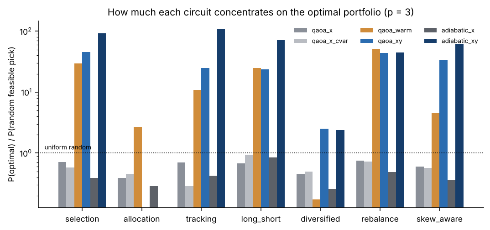
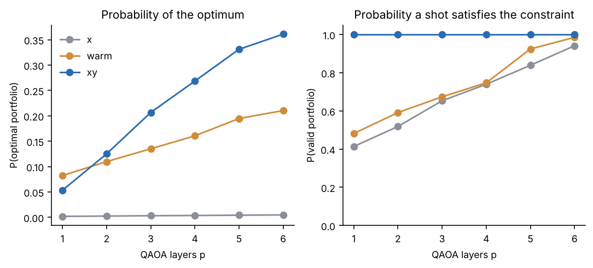
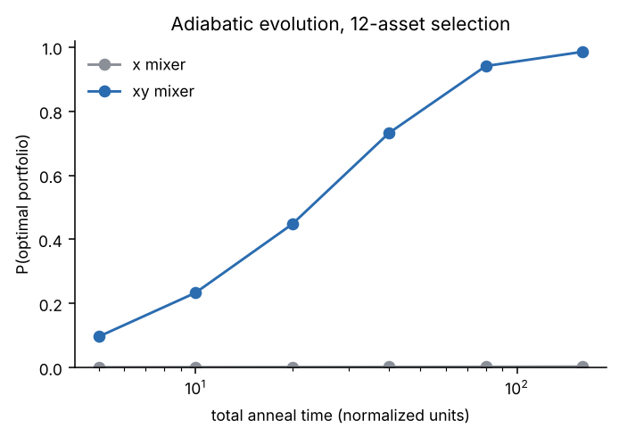
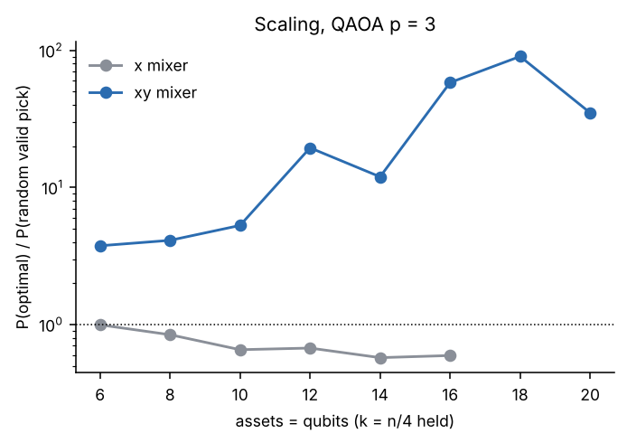
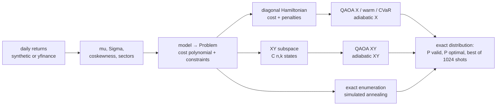

# Quantum Portfolio Optimization: seven models, one Ising format

[](https://github.com/vincal848/quantum-portfolio/actions/workflows/tests.yml)

Seven portfolio problems written as binary polynomials (QUBO and HUBO), so each
one becomes a diagonal Ising Hamiltonian. They are solved with six quantum
algorithms and two classical baselines on an exact statevector simulator.

This grew out of a project in *PHYS 4315: Introduction to Quantum Computing*
(cross-listed as *ECE 5332*), built on Thomas Wong's ***Introduction to Classical
and Quantum Computing*** and parts of Nielsen and Chuang. The starting idea was to
treat assets as nodes in a graph, with covariance on the edges, and solve the
selection with QAOA. My notes on QAOA and adiabatic quantum computing are in
[docs/BACKGROUND.md](docs/BACKGROUND.md).

## Headline results



- **The XY mixer does the work.** Penalty-based QAOA (`qaoa_x`) lands on the
  optimal portfolio *less* often than picking a valid portfolio at random (0.3–0.9×).
  The constraint-preserving XY mixer never produces an invalid portfolio and
  concentrates 24–45× above random at p = 3 on five of the six models it applies
  to. Its adiabatic version reaches 44–107×.
- **The advantage grows with size.** From 6 to 20 qubits, XY-QAOA stays 4–90× above
  random, while X-mixer QAOA slides from 0.9× to 0.5×. The XY circuit lives in the
  C(n,k)-dimensional feasible subspace, which is why 20 qubits simulates in
  seconds.
- **Adiabatic evolution converges.** With the XY mixer, P(optimal) climbs from 10% to
  99% as anneal time increases. With the X mixer it stays under 1%, because the
  penalty term dominates the energy scale and squeezes the gap.
- **Warm starts help, CVaR doesn't.** Warm-start QAOA is competitive with XY on
  several models. CVaR-QAOA improves the best shot but not the probability of
  the optimum.
- Every model's penalized ground state is its true feasible optimum. A test checks
  this for every model, so the encodings are correct.

## The models

| model | what it optimizes | qubits | order | constraint handling |
|---|---|---|---|---|
| `selection` | equal-weight mean-variance, k of n | n | 2 | hold exactly k → XY mixer |
| `allocation` | unequal weights in 1/4 units | n × 2 | 2 | units sum to budget → penalty |
| `tracking` | tracking variance vs. a cap-weighted benchmark | n | 2 | exactly k → XY mixer |
| `long_short` | dollar-neutral long/short (balanced **MaxCut**) | n | 2 | n/2 long → XY mixer |
| `diversified` | selection with no pair correlated above ρ (**independent set**) | n | 2 | XY + pair penalty |
| `rebalance` | selection plus turnover cost, ≤ 2 names per sector | n | **3** | XY + cubic penalty |
| `skew_aware` | mean-variance-**skewness** (coskewness tensor) | n | **3** | exactly k → XY mixer |

A few of these deserve a sentence each:

- **`long_short` is the graph idea made exact.** With s = ±1 for long/short, the
  portfolio variance s'Σs equals a constant minus 4 × (covariance-weighted cut
  between the books). Minimizing risk *is* weighted MaxCut on the covariance graph,
  and dollar neutrality makes it a balanced cut.
- **`rebalance` and `skew_aware` are HUBOs.** "At most 2 per sector" becomes one cubic
  term per triple, with no slack qubits. Coskewness gives three-body Z terms. The
  phase layer of QAOA applies these as easily as two-body terms, while a QUBO solver
  would need auxiliary variables for them.
- **`allocation` buys real weights with qubits.** Two bits per asset encode 0–3
  units. This is the one model the XY mixer can't help, because its constraint is a
  weighted sum rather than a count.

Results on the 12-asset synthetic market (5 sectors), p = 3:

| model | optimum | XY-QAOA P(opt) | warm P(opt) | X-QAOA P(opt) | adiabatic XY P(opt) |
|---|---|---|---|---|---|
| selection | HEA2, STA4, STA9 | 0.207 | 0.135 | 0.003 | 0.421 |
| allocation | STA4 75%, HEA2 25% | – | 0.041 | 0.006 | – |
| tracking | ENE1, FIN3, TEC10, STA9 | 0.050 | 0.022 | 0.001 | 0.217 |
| long_short | 5 long / 5 short | 0.094 | 0.099 | 0.003 | 0.283 |
| diversified | HEA2, STA4, ENE6 | 0.019 | 0.001 | 0.003 | 0.018 |
| rebalance | HEA2, STA4, TEC10, STA9 | 0.092 | 0.107 | 0.002 | 0.093 |
| skew_aware | ENE1, STA4, STA9 | 0.151 | 0.020 | 0.003 | 0.276 |

All solvers found the optimum within 1024 shots on every model except two cases:
warm-start on `diversified` and adiabatic-X on `skew_aware`. `diversified` is the
hardest case for every quantum method, because its correlation constraint still has
to be a penalty even inside the XY subspace. Simulated annealing solves all seven
in under a second; at these sizes the classical baseline is not under pressure.

Adding skewness changes the answer. At κ = 1 the optimizer gives up 8 points of
return to swap HEA2 for ENE1, a right-skewed "lottery" name. The portfolio's daily
skewness rises from 0.00 to 0.25.

## Depth, annealing time, scaling



On the 12-asset selection problem, the XY mixer's P(optimal) rises steadily with
depth, from 5% at p = 1 to 36% at p = 6. The X mixer only learns to satisfy the
constraint (41% → 94% valid) and never finds the optimum (under 0.5%).





Lowering the penalty weight on the X mixer helps a little: P(optimal) goes from
0.3% to 1.9% at 1/20 of the safe weight, and the ground state stays correct. It
doesn't close the gap. Removing the penalty with a mixer is what does.

## How it works



- **One format.** A `Problem` is a cost polynomial (linear, quadratic, cubic) plus
  constraints, each a non-negative polynomial that is zero exactly when satisfied.
  Classical solvers evaluate it; quantum solvers turn it into a phase.
- **Exact simulation.** `qportfolio/quantum.py` is a small numpy statevector engine.
  Because the cost is diagonal, each cost layer is just an elementwise phase.
  `tests/test_qiskit.py` checks it against Qiskit's `QAOAAnsatz` to 1e-10 on
  the quadratic models, which pins bit order and sign conventions.
- **Parameter training.** COBYLA at p = 1 from a ramp plus random restarts, then
  INTERP (Zhou et al.) to grow one layer at a time, so the loss never gets worse
  with depth.
- **Metrics.** P(optimal) and P(valid) come from the exact output distribution, with
  no shot noise. "× random" is P(optimal) divided by the chance of picking the
  optimum uniformly from the valid portfolios.

## Quick start

```bash
pip install -r requirements.txt
python run.py                    # all seven models, every solver (~90 s)
python run.py --all              # plus depth, anneal, penalty, scaling, frontier, figures
python run.py --model long_short # one model
python run.py --real             # real prices for 12 tickers (needs network)

pip install -r requirements-dev.txt
pytest tests -q                  # 55 tests, ~8 s, includes the Qiskit cross-check
```

```python
from qportfolio import data, models, solvers

market = data.synthetic_market(12, seed=7)
problem = models.tracking(market, k=4)
best, ref = solvers.exact(problem)
q = solvers.qaoa(problem, ref, p=3, mixer="xy")
print(problem.describe(q.x), q.info["p_optimal"], q.info["amplification"])
```

## Repository guide

| path | contents |
|---|---|
| `qportfolio/problem.py` | polynomials, penalties, Ising conversion, bit conventions |
| `qportfolio/models.py` | the seven models |
| `qportfolio/quantum.py` | statevector engine: X, XY and warm-start mixers, CVaR |
| `qportfolio/solvers.py` | exact, simulated annealing, QAOA variants, adiabatic |
| `qportfolio/qiskit_backend.py` | the same circuit in Qiskit, for cross-checks and hardware |
| `qportfolio/data.py` | synthetic factor-model market, Yahoo loader, moments |
| `qportfolio/experiments.py` | every study in this README |
| `run.py` | CLI, `results/results.json`, figures |
| `legacy/` | the original coursework scripts |

## Next models

- **Multi-period rebalancing.** Use time-indexed qubits x_{i,t} with turnover
  couplings between periods. This is a natural fit for the XY mixer, one subspace
  per period.
- **Scenario CVaR.** Minimize expected shortfall over historical scenarios, using
  slack bits per scenario. This is the downside-risk counterpart to `skew_aware`.
- **Black-Litterman views.** Fold investor views into μ; the model shape doesn't
  change, but the inputs become more realistic.
- **ESG and exclusion lists.** Linear and pairwise penalties, or fixed qubits.
- **Grover adaptive search and quantum walks** on the same feasible subspace. Quantum
  walks are where I originally wanted to take the quantum side of this.
- **Hardware runs.** `qiskit_backend.py` already builds the circuits for the
  quadratic models. The open question is how much of the XY advantage survives
  noise and a heavy-hex qubit layout.

## Notes

- Numbers come from `python run.py --all` on the seeded synthetic market and are
  recorded in `results/results.json`. Timings are single-core.
- The synthetic market is a factor model with five sectors, a crash-prone market
  factor and a few right-skewed names. The skew model needs that structure, and it
  makes the results reproducible without network access.
