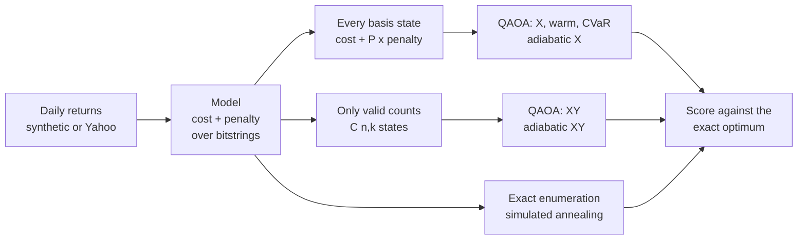

# Portfolio optimization in Ising form: seven models, six quantum solvers

[](https://github.com/vincal848/quantum-portfolio/actions/workflows/tests.yml)

Seven portfolio problems, from plain mean-variance selection to long/short books,
index tracking and skewness, all written in the one format a quantum optimizer
accepts: a function of binary variables that becomes a diagonal Ising
Hamiltonian. Each model is solved with six quantum algorithms and two classical
baselines. The circuits are simulated exactly, so we can read the full output
distribution instead of guessing from a handful of shots.

This started as a project in PHYS 4315: Introduction to Quantum Computing
(cross-listed as ECE 5332). The coursework used Thomas Wong's *Introduction to
Classical and Quantum Computing* and parts of Nielsen and Chuang. The original
idea was to treat assets as nodes in a graph with covariance on the edges, and
pick a portfolio with QAOA. One of the models below (`long_short`) turns that
picture into an exact MaxCut formulation.

## The short version

- Input: three years of daily returns for 12 assets (a seeded synthetic market,
  or real prices from Yahoo Finance).
- Seven models, each a cost and a penalty over bitstrings. Two of them have cubic
  terms, which a QUBO solver can't take directly but a QAOA circuit can.
- Six quantum solvers run on every model: QAOA with three different mixers, a
  CVaR variant, and two adiabatic anneals. Exact enumeration and simulated
  annealing are the baselines.
- The main finding: how a constraint is handled matters far more than the
  training trick. Standard QAOA, where the constraint is a penalty, finds the
  optimal portfolio no more often than picking a valid portfolio at random. The XY
  mixer, which can't break the constraint in the first place, is 24 to 50 times
  better than random on five of its six models.
- Everything comes from `python run.py` and is saved in `results/results.json`.
  The whole project is three Python files and one test file.

## Contents

1. [Why build it this way](#why-build-it-this-way)
2. [How it works](#how-it-works)
3. [The seven models](#the-seven-models)
4. [The solvers](#the-solvers)
5. [Results](#results)
6. [How we know the encodings are right](#how-we-know-the-encodings-are-right)
7. [Running it](#running-it)
8. [Limitations and what's next](#limitations-and-whats-next)
9. [Background and references](#background-and-references)

## Why build it this way

Most quantum portfolio demos solve one problem with one algorithm and report that
the answer came out right. At 10 or 12 qubits that's not saying much: a laptop
can list every portfolio in a millisecond. To learn something, the comparison has
to be set up so it can come out badly for the quantum side.

| Problem | How this repo handles it |
|---|---|
| "QAOA found the optimum" is easy at small sizes | Report P(optimal) from the exact output distribution, and compare it with random guessing among valid portfolios. |
| One model can flatter one algorithm | Seven models with different structure: equality constraints, graph constraints, cubic terms, multi-qubit weights. |
| A weak baseline makes anything look good | Exact enumeration gives the true optimum. Simulated annealing with constraint-preserving moves is the practical classical comparison. |
| A penalty weight can silently break an encoding | The weight is set just above the cost's full range, so the penalized ground state is always the best valid portfolio. A test checks this on every model. |
| A home-made simulator might be wrong | Both mixers are tested against dense matrix exponentials. |

## How it works



A model is two functions over a matrix of bitstrings, one row per basis state:
its cost, and a penalty that is zero exactly when the portfolio is valid. Every
penalty is a polynomial in the bits (a squared count, pair products, triple
products), so cost + P × penalty is a real diagonal Ising Hamiltonian. The
simulator evaluates it on every basis state at once, which makes the QAOA cost
layer a single elementwise phase.

| File | What's there |
|---|---|
| `models.py` | The synthetic market, the Yahoo loader, and the seven models |
| `qaoa.py` | Exact enumeration, simulated annealing, the three mixers, QAOA and adiabatic evolution |
| `run.py` | The comparison, the scaling study, `results/results.json` and the two figures |
| `tests/test_portfolio.py` | The checks in [How we know the encodings are right](#how-we-know-the-encodings-are-right) |
| `docs/BACKGROUND.md` | My original write-up on QAOA and adiabatic quantum computing |
| `legacy/` | The original coursework scripts, kept for reference |

## The seven models

All results below are from the default synthetic market: 12 assets in five
sectors, 756 trading days, seed 7. Asset names give the sector and an index, so
`STA4` is asset 4 and it's in consumer staples.

### 1. Selection

Pick k assets, hold them at equal weight, and maximize return minus λ times
variance:

    minimize   -mu.w + lambda w'Sigma w,   w = x / k,   sum(x) = k

Holding the weights at 1/k makes the cost the actual return and variance of the
portfolio you'd hold. It uses n qubits. With k = 3 and λ = 1 the optimum is HEA2,
STA4 and STA9: 38.4% annualized return at 23.8% volatility.

### 2. Allocation

Selection only decides in or out. Allocation decides how much. Each asset gets two
qubits that count 0 to 3 units, a unit is a quarter of the portfolio, and the units
have to add up to 4. That's 10 qubits for 5 assets, which is why this model runs on
a smaller universe. The answer is 75% STA4 and 25% HEA2, which is also where the
continuous long-only optimum lands on this market.

This is the one model the XY mixer can't help with, because its constraint is a
weighted sum of bits rather than a count of ones.

### 3. Tracking

Copy a cap-weighted benchmark with k names at equal weight, minimizing tracking
variance (w - b)' Σ (w - b). With k = 4 the best basket is ENE1, FIN3, TEC10 and
STA9, with 6.1% annualized tracking error; the worst valid basket tracks at 16.7%.

### 4. Long/short

Every asset is held long or short at 1/n, and the book is dollar neutral. With
s_i = +1 for long and -1 for short:

    s' Sigma s  =  sum(Sigma)  -  4 x (covariance between the long and short books)

So minimizing risk is weighted MaxCut on the covariance graph: assets that move
together go on opposite sides. Dollar neutrality means exactly half the names are
long, a balanced cut. This is the graph picture from the original coursework,
made exact.

On the first 10 assets the optimal book is long HEA2, STA4, ENE6, HEA7 and STA9
and short the other five. It returns 14.9% at 9.2% volatility, well under the 25
to 37% volatility of any single name.

### 5. Diversified

Selection with a rule: no two holdings may be correlated above ρ = 0.35. Draw an
edge between every such pair, and the holdings must be an independent set of size
k, a weighted maximum independent set with a cardinality constraint. The penalty
is one x_i x_j term per edge.

At ρ = 0.35 the graph has 10 edges. One of them joins STA4 and STA9 (correlation
0.59), the two staples names in the plain selection optimum. The diversified
answer keeps HEA2 and STA4 and swaps STA9 for ENE6.

### 6. Rebalance

Start from a current book (TEC0, ENE1, HEA2, FIN3) and move to a new set of k = 4
names, paying a cost per name traded and holding at most 2 names per sector.

Turnover is linear in the bits, |x_i - x0_i| = x_i (1 - 2 x0_i) + x0_i, so it needs
no extra qubits. "At most 2 per sector" would need slack qubits as a quadratic
penalty. Here it's one cubic term x_i x_j x_k per triple of names in a sector,
which is zero exactly when no sector has three holdings.

At 100 bp per trade the move is worth paying for: the optimum trades 6 names to
reach HEA2, STA4, TEC10 and STA9. As the cost rises the optimizer trades less. At
1,000 bp it makes 4 trades, at 2,000 bp it makes 2, and at 4,000 bp it stays put.

### 7. Skew-aware

Add the portfolio's skewness to the objective:

    minimize   -mu.w + lambda w'Sigma w - kappa m3(w) / s^3

m3(w) is the third central moment of the portfolio's daily return and s is the
average daily volatility of one name, so κ has no units. With w = x / k this term
is cubic in x: three-body Z terms in the Hamiltonian.

At κ = 1 the optimizer gives up about 8 points of return (38.4% to 30.1%) to swap
HEA2 for ENE1, the most right-skewed name in the market (daily skewness 1.43). The
portfolio's daily skewness goes from 0.00 to 0.25.

### Summary

| Model | Qubits | Order | Constraints | XY mixer | Valid portfolios | Optimum |
|---|---|---|---|---|---|---|
| selection | 12 | 2 | exactly 3 | yes | 220 | HEA2, STA4, STA9 |
| allocation | 10 | 2 | units sum to 4 | no | 65 | STA4 75%, HEA2 25% |
| tracking | 12 | 2 | exactly 4 | yes | 495 | ENE1, FIN3, TEC10, STA9 |
| long_short | 10 | 2 | 5 long, 5 short | yes | 252 | long HEA2, STA4, ENE6, HEA7, STA9 |
| diversified | 12 | 2 | exactly 3, 10 forbidden pairs | yes | 132 | HEA2, STA4, ENE6 |
| rebalance | 12 | 3 | exactly 4, at most 2 per sector | yes | 477 | HEA2, STA4, TEC10, STA9 |
| skew_aware | 12 | 3 | exactly 3 | yes | 220 | ENE1, STA4, STA9 |

## The solvers

Exact enumeration lists every valid portfolio and takes the best. For the
fixed-count models it only visits the C(n,k) strings with k ones. It's the
reference everything else is scored against.

Simulated annealing is Metropolis on the penalized energy, 4 restarts of 300
sweeps. For fixed-count models each move swaps one held name for one unheld name,
so the count never changes. That makes it the classical counterpart of the XY
mixer.

QAOA with the X mixer (Farhi, Goldstone and Gutmann, 2014). Start in |+>^n,
then alternate exp(-iγH_C) with exp(-iβΣX). Constraints are penalty terms inside
H_C, so the circuit is free to put probability on invalid portfolios, and it does.

CVaR-QAOA (Barkoutsos et al., 2020). The same circuit trained on the mean of
the best 10% of outcomes instead of the overall mean, which matches how you use
it: sample many times, keep the best shot.

Warm-start QAOA (Egger, Mareček and Woerner, 2021). Solve the continuous
relaxation on [0,1]^n first. Each qubit then starts tilted toward its relaxed
value (clipped to [0.25, 0.75] so none is pinned), and the mixer is rotated to
match.

QAOA with the XY mixer (Hadfield et al., 2019). Start in the Dicke state, an
equal superposition of every string with exactly k ones, and mix with XX + YY gates
on a ring of qubit pairs. Each gate swaps |01> and |10> and leaves |00> and |11>
alone, so every shot holds exactly k names and the count penalty can be left out.
The simulator stores only the C(n,k) valid amplitudes: at n = 20, k = 5 that's
15,504 numbers instead of 1,048,576.

Adiabatic evolution (Farhi et al., 2000). Start in the mixer's ground state and
slowly change the Hamiltonian from the mixer to the cost,
H(s) = (1 - s)H_M + sH_C. If that happens slowly compared with the smallest energy
gap, the system ends in the cost's ground state. It's simulated as a Trotterized
circuit with fixed angles, 40 steps over T = 20. The XY version mixes every pair,
because that mixer's ground state is the Dicke state the circuit starts in.

QAOA angles are trained with COBYLA at depth p = 3. Depth 1 starts from a small
ramp and three random points; each extra layer starts from the previous optimum
stretched onto one more layer (INTERP, Zhou et al., 2020). Energies are
standardized before entering the circuit, so one angle range works for every model.

## Results

### Every model, every solver

Each bar is P(optimal) divided by the chance of hitting the optimum by picking a
valid portfolio at random. Above the dotted line the circuit beats random; below
it, it doesn't.


P(optimal) per shot:

| Model | XY-QAOA | Warm-start | X-QAOA | CVaR | Adiabatic XY | Adiabatic X |
|---|---|---|---|---|---|---|
| selection | 0.203 | 0.140 | 0.003 | 0.003 | 0.421 | 0.002 |
| allocation | n/a | 0.043 | 0.006 | 0.007 | n/a | 0.005 |
| tracking | 0.050 | 0.022 | 0.002 | 0.001 | 0.217 | 0.001 |
| long_short | 0.095 | 0.101 | 0.003 | 0.004 | 0.283 | 0.004 |
| diversified | 0.025 | 0.001 | 0.004 | 0.004 | 0.047 | 0.002 |
| rebalance | 0.105 | 0.077 | 0.002 | 0.002 | 0.203 | 0.001 |
| skew_aware | 0.151 | 0.019 | 0.003 | 0.003 | 0.276 | 0.002 |

What the table says:

- Every X-mixer method is at or below random on every model (0.28 to 1.01 times).
  Plain X-QAOA spends much of its probability on invalid portfolios: 10 to 61% of
  its shots break a constraint.
- The XY mixer is 24 to 50 times better than random on selection, tracking,
  long_short, rebalance and skew_aware. The adiabatic XY anneal is 61 to 107 times
  better on the same five.
- Warm starts close much of the gap on some models (37 times random on rebalance,
  31 on selection) and do little on others (4 on skew_aware, below random on
  diversified). The relaxation is a good guide only when the continuous optimum
  sits near the binary one.
- CVaR training barely moves P(optimal). It changes which tail the circuit
  optimizes, and with 1024 shots the best shot was usually already the optimum.
- diversified is the hard case for every method (XY only 3.3 times random). Its
  correlation rule still has to be a penalty inside the XY subspace, and that
  penalty flattens the landscape the same way the count penalty does for the X
  mixer.

In 1024 shots, XY-QAOA, adiabatic XY, plain X-QAOA and simulated annealing found
the exact optimum on every model. The misses were adiabatic X on five models, CVaR
on tracking and warm start on diversified. Simulated annealing took under 2.5
seconds per model.

### Scaling


Selection with k = n/4 on 3 random markets per size, p = 3:

| Assets | 6 | 8 | 10 | 12 | 14 | 16 | 18 | 20 |
|---|---|---|---|---|---|---|---|---|
| XY: times random | 3.8 | 4.1 | 5.3 | 19.4 | 12.0 | 58.2 | 90.3 | 35.0 |
| X: times random | 1.0 | 0.8 | 0.7 | 0.7 | 0.6 | 0.6 | | |
| XY: found optimum | 3/3 | 3/3 | 3/3 | 3/3 | 3/3 | 3/3 | 3/3 | 3/3 |
| X: found optimum | 3/3 | 3/3 | 3/3 | 3/3 | 2/3 | 1/3 | | |

The X mixer stops at 16 qubits: the full state is 65,536 amplitudes and a training
run takes about 30 seconds, against 5 seconds for XY at 20 qubits. The X mixer
drifts further below random as the problem grows and starts missing the optimum
at 14 assets. The XY mixer stays well above random and found the optimum in every
trial.

## How we know the encodings are right

| Check | How |
|---|---|
| Each cost is the statistic it claims | Compared with the formula computed directly from weights: mean-variance, tracking variance, the long/short MaxCut identity, turnover, and the third moment from the full coskewness tensor |
| Penalties are zero exactly on valid portfolios | Checked on every state against direct counts (sector caps) and direct edge checks (correlation graph) |
| The penalty weight is large enough | For all seven models, the ground state of the full penalized Hamiltonian is the true best valid portfolio |
| Allocation covers every split | The valid states are exactly the 31 ways to split 4 quarters across 4 assets |
| The X mixer | Matches `expm(-iβΣX)` |
| The XY mixer | Matches dense exponentials of (XX + YY)/2 and leaves no amplitude outside the valid subspace |
| Warm start | The initial state's marginals equal the relaxed solution |
| The main result | A test requires XY-QAOA's P(optimal) to beat X-QAOA's by at least 5 times |

## Running it

```bash
pip install -r requirements.txt      # Python 3.11+

python run.py                        # comparison and scaling study, ~6 min
python run.py --real                 # same comparison on 12 real tickers, 2020-2022
pytest -q                            # 18 tests, ~8 s
```

From Python:

```python
import models, qaoa

model = models.tracking(models.synthetic_market(), k=4)
ref = qaoa.exact(model)
result = qaoa.qaoa(model, ref, mixer="xy")
print(model.describe(result["x"]), result["p_optimal"], result["amplification"])
```

A new model is a `Model` with a cost and a penalty over a bitstring matrix. If it
holds a fixed number of names, set `k` and the XY mixer and the swap-move annealer
use it automatically.

## Limitations and what's next

- Nothing here is beyond a laptop. Exact enumeration solves every model instantly
  and simulated annealing solves each in a couple of seconds. The results compare
  quantum methods with each other and with random guessing; they make no speed-up
  claim.
- Simulation is noiseless. Real hardware adds gate errors, and the XY mixer's ring
  of two-qubit gates doesn't map directly onto most chips' connectivity. How much
  of the XY advantage survives that is the obvious next experiment.
- The synthetic market is a factor model, not real prices. It has sectors, crashes
  and skew built in and makes every number reproducible. The real-data path works
  but wasn't used for the figures.
- Estimation error is ignored: μ and Σ are treated as known.

Models I'd add next:

- Multi-period rebalancing, with a qubit per asset and period and turnover terms
  linking consecutive periods.
- Scenario CVaR: minimize expected shortfall over historical days, the downside-risk
  counterpart to skew_aware.
- Black-Litterman views folded into μ.
- Grover adaptive search and quantum walks over the same valid subspace. Quantum
  walks are where I first wanted to take the quantum side of this project.

## Background and references

My notes from the course on the classical/quantum comparison, QAOA and adiabatic
quantum computing are in [docs/BACKGROUND.md](docs/BACKGROUND.md).

- E. Farhi, J. Goldstone, S. Gutmann, M. Sipser (2000). Quantum computation by
  adiabatic evolution. arXiv:quant-ph/0001106.
- E. Farhi, J. Goldstone, S. Gutmann (2014). A quantum approximate optimization
  algorithm. arXiv:1411.4028.
- S. Hadfield et al. (2019). From the quantum approximate optimization algorithm to
  a quantum alternating operator ansatz. Algorithms 12(2), 34.
- P. Barkoutsos et al. (2020). Improving variational quantum optimization using
  CVaR. Quantum 4, 256.
- L. Zhou et al. (2020). Quantum approximate optimization algorithm: performance,
  mechanism, and implementation on near-term devices. Physical Review X 10, 021067.
- D. Egger, J. Mareček, S. Woerner (2021). Warm-starting quantum optimization.
  Quantum 5, 479.
- T. Wong (2022). Introduction to Classical and Quantum Computing. Rooted Grove.
- M. Nielsen, I. Chuang (2010). Quantum Computation and Quantum Information.
  Cambridge University Press.
