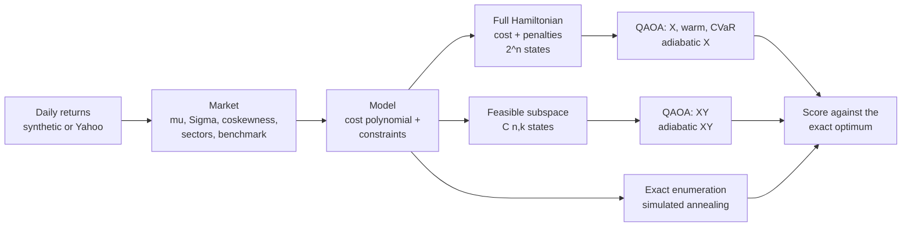
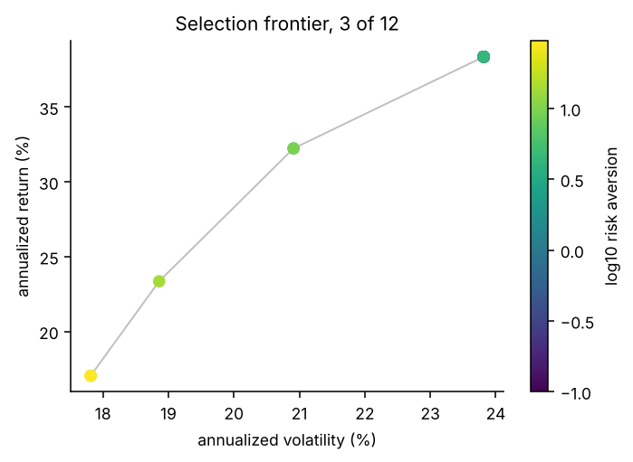

# Portfolio optimization in Ising form: seven models, six quantum solvers

[](https://github.com/vincal848/quantum-portfolio/actions/workflows/tests.yml)

Seven portfolio problems, from plain mean-variance selection to long/short books,
index tracking and skewness, all written in the one format a quantum optimizer
accepts: a polynomial over binary variables, which becomes a diagonal Ising
Hamiltonian. Each model is solved with six quantum algorithms and two classical
baselines. The quantum circuits are simulated exactly, so we can measure the full
output distribution instead of guessing from a handful of shots.

This started as a project in PHYS 4315: Introduction to Quantum Computing
(cross-listed as ECE 5332). The coursework used Thomas Wong's *Introduction to
Classical and Quantum Computing* and parts of Nielsen and Chuang. The original
idea was to treat assets as nodes in a graph with covariance on the edges, and
pick a portfolio with QAOA. One of the models below (`long_short`) turns that
picture into an exact MaxCut formulation.

## The short version

- Input: three years of daily returns for 12 assets (a seeded synthetic market,
  or real prices from Yahoo Finance).
- Seven models compile to the same `Problem` type: a cost polynomial plus
  constraints. Two of them are cubic (HUBO), which a QUBO solver can't take
  directly but a QAOA circuit can.
- Six quantum solvers run on every model: QAOA with three different mixers, a
  CVaR variant, and two adiabatic anneals. Exact enumeration and simulated
  annealing are the baselines.
- The main finding: how a constraint is handled matters far more than circuit
  depth or the training trick. Standard QAOA, where the constraint is a penalty,
  finds the optimal portfolio less often than picking a valid portfolio at
  random. The XY mixer, which can't break the constraint in the first place, is
  24 to 45 times better than random on five of its six models. Annealed slowly,
  it reaches 99%.
- Every number here comes from one command, `python run.py --all`, and is saved
  in `results/results.json`. The 55 tests run in about 10 seconds.

## Contents

1. [Why build it this way](#why-build-it-this-way)
2. [The pipeline at a glance](#the-pipeline-at-a-glance)
3. [The seven models](#the-seven-models)
4. [The solvers](#the-solvers)
5. [Results](#results)
6. [How we know the encodings are right](#how-we-know-the-encodings-are-right)
7. [Engineering notes](#engineering-notes)
8. [Running it](#running-it)
9. [Repository map](#repository-map)
10. [Limitations and what's next](#limitations-and-whats-next)
11. [Background and references](#background-and-references)

## Why build it this way

Most quantum portfolio demos solve one problem with one algorithm and report that
the answer came out right. At 10 or 12 qubits that's not saying much: a laptop
can list every portfolio in a millisecond. To learn something, the comparison has
to be set up so it can come out badly for the quantum side.

| Problem | How this repo handles it |
|---|---|
| "QAOA found the optimum" is easy at small sizes | Report P(optimal) from the exact output distribution, and compare it with random guessing among valid portfolios (the amplification factor). |
| One model can flatter one algorithm | Seven models with different structure: equality constraints, graph constraints, cubic terms, multi-qubit weights. |
| A weak baseline makes anything look good | Exact enumeration gives the true optimum. Simulated annealing with constraint-preserving moves is the practical classical comparison. |
| Penalty weights can silently break an encoding | Each model's penalty weight comes from a bound that guarantees the penalized ground state is feasible. A test checks every model by brute force. |
| A home-made simulator might be wrong | The numpy engine is checked against Qiskit's own `QAOAAnsatz` on four models, to within 1e-10. |
| Results that depend on network data rot | A seeded synthetic market makes every figure reproducible offline. Real data is one flag away. |

## The pipeline at a glance



| Step | What happens | Code |
|---|---|---|
| 1. Market | Daily returns become annualized mean and covariance, plus daily coskewness, sectors and a benchmark | `qportfolio/data.py` |
| 2. Model | A model writes its objective as a polynomial in binary variables, and each constraint as a polynomial that is zero exactly when it holds | `qportfolio/models.py` |
| 3. Hamiltonian | Cost plus weighted penalties, evaluated on every basis state. If the XY mixer applies, the cardinality penalty is dropped and only valid states are stored | `qportfolio/problem.py` |
| 4. Circuit | Cost phase and mixer alternate; angles are trained (QAOA) or fixed by a schedule (adiabatic) | `qportfolio/quantum.py`, `qportfolio/solvers.py` |
| 5. Read out | 1024 shots are drawn and the best valid one is kept. P(valid) and P(optimal) are read exactly from the distribution | `qportfolio/solvers.py` |
| 6. Score | Everything is compared with the exact optimum | `qportfolio/experiments.py` |

## The seven models

All results in this section are from the default synthetic market: 12 assets in
five sectors, 756 trading days, seed 7. Asset names give the sector and an index,
so `STA4` is the fourth asset and it's in consumer staples.

### 1. Selection

Pick k assets, hold them at equal weight, and maximize return minus λ times
variance:

    minimize   -mu.w + lambda w'Sigma w,   w = x / k,   sum(x) = k

Holding the weights at 1/k makes the cost the actual return and variance of the
portfolio you'd hold, not of the raw 0/1 vector. It uses n qubits.

With k = 3 and λ = 1 the optimum is HEA2, STA4 and STA9: 38.4% annualized return
at 23.8% volatility, a Sharpe ratio of 1.48 against a 3% risk-free rate. Sweeping
λ from 0.1 to 30 traces the frontier below. The selection holds until λ is about
5, then shifts toward lower-volatility names (17.0% return at 17.8% volatility at
λ = 30). XY-QAOA found the exact optimum at every point on the sweep.



### 2. Allocation

Selection only decides in or out. Allocation decides how much. Each asset gets two
qubits that count 0 to 3 units, a unit is a quarter of the portfolio, and the
units have to add up to 4:

    w_i = (x_i0 + 2 x_i1) / 4,   sum of units = 4

That's 10 qubits for 5 assets, which is why this model runs on a smaller
universe. The answer is 75% STA4 and 25% HEA2. The continuous long-only Markowitz
optimum (with the same 75% cap) lands on exactly the same weights here, so
rounding to quarters cost nothing on this market.

This is the one model the XY mixer can't help with, because its constraint is a
weighted sum of bits rather than a count of ones.

### 3. Tracking

Copy a cap-weighted benchmark with k names at equal weight, minimizing tracking
variance:

    minimize   (w - b)' Sigma (w - b)

With k = 4 the best basket is ENE1, FIN3, TEC10 and STA9, with 6.1% annualized
tracking error. The worst valid basket tracks at 16.7%. The cost has a different
shape from selection (it's anchored to b, and returns don't enter at all), but it
has the same "exactly k" constraint, so the XY mixer applies.

### 4. Long/short

Every asset is held long or short at 1/n, and the book is dollar neutral. With
s_i = +1 for long and -1 for short:

    s' Sigma s  =  sum(Sigma)  -  4 x (covariance between the long and short books)

So minimizing risk is weighted MaxCut on the covariance graph: assets that move
together go on opposite sides. Dollar neutrality means exactly half the names are
long, a balanced cut. This is the graph picture from the original coursework,
made exact.

On the first 10 assets the optimal book is long HEA2, STA4, ENE6, HEA7 and STA9
and short the other five. It returns 14.9% at 9.2% volatility, well under the
25 to 37% volatility of any single name.

### 5. Diversified

Selection with a rule: no two holdings may be correlated above ρ = 0.35. Draw an
edge between every such pair, and the holdings must be an independent set of size
k, so this is weighted maximum independent set with a cardinality constraint. The
penalty is one quadratic term per edge.

At ρ = 0.35 the graph has 10 edges. One of them joins STA4 and STA9 (correlation
0.59), the two staples names in the plain selection optimum. The diversified
answer keeps HEA2 and STA4 and swaps STA9 for ENE6.

### 6. Rebalance

Start from a current book (TEC0, ENE1, HEA2, FIN3) and move to a new set of
k = 4 names, paying a cost per name traded and holding at most 2 names per
sector.

Turnover is linear in binary variables, because |x_i - x0_i| = x_i (1 - 2 x0_i) + x0_i,
so it costs no extra qubits. "At most 2 per sector" is the interesting part. The
usual quadratic encoding needs slack qubits; here it's one cubic term
x_i x_j x_k for every triple of names in the same sector, which is zero exactly
when no sector has three holdings.

At 100 bp per trade the move is worth paying for: the optimum trades 6 names to
reach HEA2, STA4, TEC10 and STA9. As the cost rises the optimizer trades less.
At 1,000 bp it makes 4 trades, at 2,000 bp it makes 2, and at 4,000 bp it stays
where it is.

### 7. Skew-aware

Add the portfolio's skewness to the objective:

    minimize   -mu.w + lambda w'Sigma w - kappa m3(w) / s^3

m3(w) is the third central moment of the portfolio's daily return, built from the
12 x 12 x 12 coskewness tensor, and s is the average daily volatility of one name,
so kappa has no units. With w = x / k this term is cubic in x: three-body Z terms
in the Hamiltonian.

At κ = 1 the optimizer gives up about 8 points of return (38.4% to 30.1%) to swap
HEA2 for ENE1, the most right-skewed name in the market (daily skewness 1.43).
The portfolio's daily skewness goes from 0.00 to 0.25.

### Summary

| Model | Qubits | Order | Constraints | XY mixer | Valid portfolios | Optimum |
|---|---|---|---|---|---|---|
| selection | 12 | 2 | exactly 3 | yes | 220 | HEA2, STA4, STA9 |
| allocation | 10 | 2 | units sum to 4 | no | 65 | STA4 75%, HEA2 25% |
| tracking | 12 | 2 | exactly 4 | yes | 495 | ENE1, FIN3, TEC10, STA9 |
| long_short | 10 | 2 | 5 long, 5 short | yes | 252 | long HEA2, STA4, ENE6, HEA7, STA9 |
| diversified | 12 | 2 | exactly 3, 10 forbidden pairs | yes | 132 | HEA2, STA4, ENE6 |
| rebalance | 12 | 3 | exactly 4, at most 2 per sector | yes | 477 | HEA2, STA4, TEC10, STA9 |
| skew_aware | 12 | 3 | exactly 3 | yes | 220 | ENE1, STA4, STA9 |

## The solvers

### Classical

`exact` lists every valid portfolio and takes the best. For the fixed-cardinality
models it only visits the C(n,k) strings with k ones, so it runs to 20+ assets in
well under a second. It's the reference everything else is scored against.

`simulated_annealing` is Metropolis annealing on the penalized energy, 4 restarts
of 300 sweeps. For fixed-cardinality models each move swaps one held name for one
unheld name, so it never leaves the right number of holdings. That makes it the
classical counterpart of the XY mixer.

### QAOA with the X mixer

The standard algorithm (Farhi, Goldstone and Gutmann, 2014). Start in the uniform
superposition |+>^n, then alternate exp(-iγH_C) with exp(-iβΣX). Constraints are
penalty terms inside H_C. The circuit is free to put probability on invalid
portfolios, and it does.

### CVaR-QAOA

The same circuit trained on a different loss (Barkoutsos et al., 2020). Instead
of the mean energy it minimizes the mean of the best 10% of outcomes, which
matches how the circuit is actually used: sample many times, keep the best shot.

### Warm-start QAOA

Egger, Mareček and Woerner (2021). First solve the continuous relaxation of the
problem on [0,1]^n. Each qubit then starts tilted toward its relaxed value
(clipped to [0.25, 0.75] so no qubit is pinned), and the mixer is rotated to
match. At p = 1 the circuit already reproduces the relaxation, so the training
starts from a sensible place.

### QAOA with the XY mixer

The quantum alternating operator ansatz (Hadfield et al., 2019). Start in the
Dicke state, an equal superposition of every string with exactly k ones. Mix with
XX + YY gates on a ring of qubit pairs; each gate swaps |01> and |10> and leaves
|00> and |11> alone. The number of ones never changes, so every shot is a valid
portfolio and the cardinality penalty can be left out of the Hamiltonian.

The simulator stores only the C(n,k) valid amplitudes. At n = 20, k = 5 that's
15,504 numbers instead of 1,048,576, which is why the XY scaling study reaches 20
qubits in seconds.

### Adiabatic evolution

The continuous-time idea behind QAOA (Farhi et al., 2000). Start in the mixer's
ground state and slowly change the Hamiltonian from the mixer to the cost:
H(s) = (1 - s)H_M + sH_C. If the change is slow compared with the smallest energy
gap, the system ends up in the cost's ground state. It's simulated as a
Trotterized circuit with fixed angles and nothing trained: 40 steps over T = 20
in the comparison table, 4 steps per unit of time in the anneal study. The XY version
uses the complete-graph mixer, because its ground state is the Dicke state the
circuit starts in.

### Training details

QAOA angles are trained with COBYLA. Depth 1 is trained from a small ramp and from
3 random starts. Each extra layer starts from the previous optimum interpolated
onto one more layer (INTERP, Zhou et al., 2020), so the loss can't get worse as p
grows. Energies are standardized before entering the circuit, so the same angle
range works for every model whatever its units.

## Results

### Every model, every solver

Each bar is P(optimal) divided by the chance of hitting the optimum by picking a
valid portfolio at random. Above the dotted line the circuit is doing better than
random; below it, worse.


P(optimal) per shot at p = 3:

| Model | XY-QAOA | Warm-start | X-QAOA | CVaR | Adiabatic XY | Adiabatic X |
|---|---|---|---|---|---|---|
| selection | 0.207 | 0.135 | 0.003 | 0.003 | 0.421 | 0.002 |
| allocation | n/a | 0.041 | 0.006 | 0.007 | n/a | 0.005 |
| tracking | 0.050 | 0.022 | 0.001 | 0.001 | 0.217 | 0.001 |
| long_short | 0.094 | 0.099 | 0.003 | 0.004 | 0.283 | 0.003 |
| diversified | 0.019 | 0.001 | 0.003 | 0.004 | 0.018 | 0.002 |
| rebalance | 0.092 | 0.107 | 0.002 | 0.002 | 0.093 | 0.001 |
| skew_aware | 0.151 | 0.020 | 0.003 | 0.003 | 0.276 | 0.002 |

What the table says:

- Every X-mixer method is below random on every model (0.26 to 0.95 times).
  Plain X-QAOA puts much of its probability on invalid portfolios: 29 to 61% of
  its shots break a constraint.
- The XY mixer is 24 to 45 times better than random on selection, tracking,
  long_short, rebalance and skew_aware, and the adiabatic XY anneal is 44 to 107
  times better.
- Warm starts close much of the gap on some models (51 times random on rebalance,
  30 on selection) and help little on others (4.5 on skew_aware, below random on
  diversified). The relaxation is a good guide only when the continuous optimum
  sits near the binary one.
- CVaR training barely moves P(optimal). It changes which tail the circuit
  optimizes, and with 1024 shots the best shot was already the optimum.
- diversified is the hard case for every method. Its correlation rule still has
  to be a penalty even inside the XY subspace, and that penalty flattens the
  landscape the same way the cardinality penalty does for the X mixer.

In 1024 shots every method found the exact optimum on every model except two:
warm-start on diversified and adiabatic X on skew_aware. Simulated annealing
solved all seven in under 0.7 seconds each.

### Depth


On 12-asset selection, more layers help the XY mixer steadily: P(optimal) goes from
5.3% at p = 1 to 36.1% at p = 6. The X mixer uses its extra layers to learn the
constraint (P(valid) rises from 41% to 94%) without getting any closer to the
optimum, which stays under 0.5%. Warm start sits between them, from 8.2% to 21.0%.

### Anneal time


| Total time | 5 | 10 | 20 | 40 | 80 | 160 |
|---|---|---|---|---|---|---|
| P(optimal), XY mixer | 0.097 | 0.234 | 0.448 | 0.732 | 0.941 | 0.986 |
| P(optimal), X mixer | 0.001 | 0.001 | 0.002 | 0.002 | 0.003 | 0.003 |

The XY anneal behaves the way the adiabatic theorem says it should: slower is
better, and at T = 160 it's right 98.6% of the time. The X anneal barely moves.
The penalty terms dominate its energy scale, so the differences between valid
portfolios are a tiny fraction of the spectrum and the gap the anneal has to
respect is tiny too.

### Penalty weight

If the penalty is the problem, a smaller penalty should help. It does, a little:

| Penalty scale (1 = safe bound) | 0.05 | 0.10 | 0.25 | 0.50 | 1.00 |
|---|---|---|---|---|---|
| X-QAOA P(optimal) | 0.019 | 0.006 | 0.004 | 0.004 | 0.003 |
| Ground state still the optimum? | yes | yes | yes | yes | yes |

Cutting the weight 20 times gives a 6 times better P(optimal), still a tenth of
what the XY mixer gets. Tuning the penalty doesn't fix the issue; taking the
constraint out of the Hamiltonian does.

### Scaling


Selection with k = n/4, 3 random markets per size, p = 3:

| Assets | 6 | 8 | 10 | 12 | 14 | 16 | 18 | 20 |
|---|---|---|---|---|---|---|---|---|
| XY: times random | 3.8 | 4.1 | 5.3 | 19.4 | 11.9 | 58.1 | 90.3 | 34.8 |
| X: times random | 0.9 | 0.8 | 0.7 | 0.6 | 0.6 | 0.5 | | |
| XY: found optimum | 3/3 | 3/3 | 3/3 | 3/3 | 3/3 | 3/3 | 3/3 | 3/3 |
| X: found optimum | 3/3 | 3/3 | 3/3 | 3/3 | 2/3 | 1/3 | | |

The X mixer stops at 16 qubits because the full state is 65,536 amplitudes and
each training run takes about 30 seconds; the XY run at 20 qubits takes 4. The
X mixer drifts further below random as the problem grows and starts missing the
optimum at 14 assets. The XY mixer stays well above random and found the optimum
in every trial.

## How we know the encodings are right

A comparison like this is only as good as the encodings. Each piece is tested
against something independent:

| Check | How |
|---|---|
| Every model's cost is the statistic it claims | Tested against the formula computed directly from weights: equal-weight mean-variance, tracking variance, the long/short MaxCut identity, turnover, the third moment from raw returns |
| Penalties are correct | Each penalty is zero on exactly the states that satisfy the constraint, checked on every state |
| The penalty weight is large enough | For all seven models, the ground state of the full penalized Hamiltonian is the true feasible optimum (brute force over all 2^n states) |
| Ising conversion | `to_ising` reproduces the polynomial on every state |
| The XY mixer | Matches dense matrix exponentials of (XX + YY)/2, keeps every amplitude in the weight-k subspace, and preserves the norm |
| The X mixer | Matches `expm(-iβΣX)` |
| The whole engine | Output probabilities match Qiskit's `QAOAAnsatz` + `Statevector` to 1e-10 on four models |
| Training | INTERP never makes the loss worse with depth; seeded runs reproduce exactly |
| The main result | A test requires XY-QAOA's P(optimal) to beat X-QAOA's by at least 5 times, so a regression shows up as a failure |

## Engineering notes

- One problem format. A model only has to produce a cost polynomial and a list of
  constraints. The solvers never know which model they're running.
- Exact simulation. The cost Hamiltonian is diagonal, so the cost layer is an
  elementwise phase. A full 12-qubit QAOA training run takes 1 to 5 seconds on one
  core.
- Determinism. The market, the simulated annealing, the random restarts and the
  shot sampling are all seeded. Re-running `python run.py --all` reproduces
  `results/results.json`.
- Light dependencies. The core needs numpy 2 and scipy. Qiskit is only used by
  the cross-check test and `qiskit_backend.py`; pandas and yfinance only by the
  real-data loader.
- CI runs the fast tests on Python 3.11 to 3.13, and the Qiskit cross-check in a
  separate job.

## Running it

```bash
pip install -r requirements.txt          # Python 3.11+

python run.py                            # the seven-model comparison (~90 s)
python run.py --all                      # plus depth, anneal, penalty, scaling,
                                         # frontier, and the figures (several minutes)
python run.py --model long_short         # one model
python run.py --real                     # real prices for 12 tickers, 2020-2022
python run.py --p 5                      # deeper circuits

pip install -r requirements-dev.txt
pytest tests -q                          # 55 tests, ~10 s
pytest tests -q -m "not slow"            # skip the Qiskit cross-check
```

Using it from Python:

```python
from qportfolio import data, models, solvers

market = data.synthetic_market(12, seed=7)
problem = models.tracking(market, k=4)

best, ref = solvers.exact(problem)
result = solvers.qaoa(problem, ref, p=3, mixer="xy")

print(problem.describe(result.x))           # ENE1 +25%, FIN3 +25%, ...
print(result.info["p_optimal"])             # probability per shot
print(result.info["amplification"])         # times better than random
```

A new model is a function that returns a `Problem`. If its constraint is "exactly
k ones", set `hamming_weight=k` and name that constraint `"cardinality"`, and the
XY mixer and the swap-move annealer will pick it up automatically.

## Repository map

| Path | What's there |
|---|---|
| `qportfolio/problem.py` | Polynomials, penalties, Ising conversion, the `Problem` type, bit conventions |
| `qportfolio/models.py` | The seven models, plus the continuous Markowitz reference |
| `qportfolio/quantum.py` | The statevector engine: X, XY and warm-start mixers, CVaR |
| `qportfolio/solvers.py` | Exact, simulated annealing, QAOA, adiabatic, and the shot read-out |
| `qportfolio/qiskit_backend.py` | The same circuits in Qiskit, for cross-checks and hardware |
| `qportfolio/data.py` | The synthetic market, the Yahoo loader, moments |
| `qportfolio/metrics.py` | Return, volatility, Sharpe on an annual basis |
| `qportfolio/experiments.py` | Every study in this README |
| `run.py` | The command line, `results/`, and the figures in `docs/img/` |
| `tests/` | The checks listed above |
| `docs/BACKGROUND.md` | My original write-up on QAOA and adiabatic quantum computing |
| `legacy/` | The original coursework scripts, kept for reference |

## Limitations and what's next

- Nothing here is beyond a laptop. Exact enumeration solves every model instantly
  and simulated annealing solves them all in under a second. The results compare
  quantum methods with each other and with random guessing; they make no
  speed-up claim.
- Simulation is noiseless. Real hardware adds gate errors, and the XY mixer's
  two-qubit gates on a ring don't map directly onto most chips' connectivity. How
  much of the 24 to 45 times advantage survives that is the obvious next
  experiment. `qiskit_backend.py` already builds the circuits for the quadratic
  models.
- The synthetic market is a factor model, not real prices. It was chosen so
  sectors, crashes and skew are all present and every number reproduces. The real
  data path works but wasn't used for the figures.
- Estimation error is ignored. The models treat mu and Sigma as known; in practice
  they're noisy, and mean estimates especially so.

Models I'd add next:

- Multi-period rebalancing, with qubits x_{i,t} for each asset and period and
  turnover terms coupling consecutive periods. Each period's cardinality is its
  own XY subspace.
- Scenario CVaR: minimize expected shortfall over historical days, using slack
  bits per scenario. The downside-risk counterpart to skew_aware.
- Black-Litterman views folded into mu. Same model shapes, more realistic inputs.
- ESG screens and exclusion lists, as fixed qubits or pairwise penalties.
- Grover adaptive search and quantum walks over the same feasible subspace.
  Quantum walks are where I wanted to take the quantum side of this project
  originally.

## Background and references

My notes from the course on the classical/quantum comparison, QAOA and adiabatic
quantum computing are in [docs/BACKGROUND.md](docs/BACKGROUND.md).

- E. Farhi, J. Goldstone, S. Gutmann, M. Sipser (2000). Quantum computation by
  adiabatic evolution. arXiv:quant-ph/0001106.
- E. Farhi, J. Goldstone, S. Gutmann (2014). A quantum approximate optimization
  algorithm. arXiv:1411.4028.
- S. Hadfield et al. (2019). From the quantum approximate optimization algorithm to
  a quantum alternating operator ansatz. Algorithms 12(2), 34.
- P. Barkoutsos et al. (2020). Improving variational quantum optimization using
  CVaR. Quantum 4, 256.
- L. Zhou et al. (2020). Quantum approximate optimization algorithm: performance,
  mechanism, and implementation on near-term devices. Physical Review X 10, 021067.
- D. Egger, J. Mareček, S. Woerner (2021). Warm-starting quantum optimization.
  Quantum 5, 479.
- T. Wong (2022). Introduction to Classical and Quantum Computing. Rooted Grove.
- M. Nielsen, I. Chuang (2010). Quantum Computation and Quantum Information.
  Cambridge University Press.
